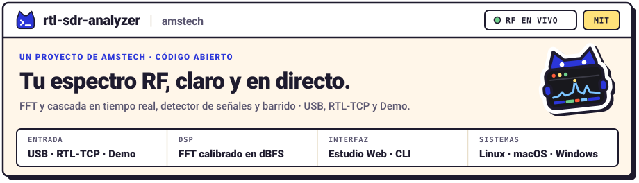
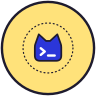

<p align="center">
  
</p>

<p align="center">
  <a href="https://github.com/msalexms/rtl-sdr-analyzer/actions/workflows/ci.yml"></a>
  <a href="https://www.python.org"></a>
  
  
  <a href="LICENSE"></a>
</p>

<p align="center">
  <a href="README.md">English</a> · <strong>Español</strong>
</p>

<p align="center">
  <a href="#características">Características</a> ·
  <a href="#inicio-rápido">Inicio rápido</a> ·
  <a href="#estudio-web">Estudio Web</a> ·
  <a href="#comandos-cli">Comandos CLI</a> ·
  <a href="#configuración">Configuración</a> ·
  <a href="#arquitectura">Arquitectura</a> ·
  <a href="CHANGELOG.md">Changelog</a>
</p>

---

**rtl-sdr-analyzer** (de **AMSTech**) es un analizador de espectro RF sencillo, directo y fiable para receptores USB RTL-SDR y servidores `rtl_tcp`, con detector de señales, grabador IQ y barrido de banda ancha.

Sin decenas de paneles complicados ni ventanas de matplotlib inestables: incluye un Estudio Web local (sin paso de compilación) y una CLI clara que funcionan desde el primer minuto con:

- **USB RTL-SDR directo** mediante bindings `ctypes` a `librtlsdr` (sin compilar nada en C)
- **Red `rtl_tcp`** con handshake `RTL0` real y trama I/Q siempre alineada
- **Demo RF simulada** cuando no hay receptor conectado, para probar todo en cualquier equipo
- **Reproducción de ficheros IQ** (`.raw` / `.cu8` y `.npz`)

---

## Características

- **Espectro y cascada en directo** — Gráfica Canvas HTML5 fluida sobre WebSocket (`Int16` Base64), con clic para sintonizar, lectura bajo el cursor, Peak Hold, Auto Escala y mapas de color AMSTech / Viridis / Inferno.
- **DSP calibrado en dBFS** — FFT Welch en NumPy puro con ventanas seleccionables (`blackmanharris`, `hann`, `hamming`, `rectangular`), eliminación de DC y suavizado temporal lineal.
- **Detector de señales adaptativo** — Suelo de ruido robusto (mediana/MAD), ancho de banda contiguo a `-3 dB`, criterios de potencia + SNR + Z-score, retención y cooldown antispam.
- **Barrido de banda ancha** — Recorre rangos amplios recortando los bordes del filtro (`0.8 × sample_rate`) para dibujar un espectro compuesto limpio y una tabla de picos clicable.
- **Grabación IQ** — Captura en bruto `uint8` (`.raw` / `.cu8`) o archivos `.npz` (con frecuencia, muestreo y ganancia) desde la web o la terminal.
- **Historial SQLite y exportación** — Base de datos SQLite en modo WAL segura entre hilos, sesiones, frecuencias más activas, actividad por horas y exportación a CSV / JSONL.
- **Identidad AMSTech (`ES / EN`)** — Modo Día papel cálido (`#FFF6E9`) y modo Noche grafito suave (`#18181D`), tipografías locales (`Bricolage Grotesque`, `Figtree`, `DM Mono`) y cero peticiones externas.

---

## Inicio rápido

### 1. Instalación

```bash
git clone https://github.com/msalexms/rtl-sdr-analyzer.git
cd rtl-sdr-analyzer

python -m venv .venv
source .venv/bin/activate        # Linux / macOS
# .venv\Scripts\activate         # Windows

pip install -e .
```

> [!NOTE]
> **Drivers USB:** En Linux/macOS instala `librtlsdr` (`sudo apt install librtlsdr0 rtl-sdr` o `brew install librtlsdr`). En Windows instala el driver WinUSB con Zadig y asegúrate de tener `rtlsdr.dll` en `PATH`, `RTL_SDR_LIB` o en una carpeta `sdrpp` / `rtl-sdr`.

### 2. Comprueba tu receptor

```bash
rtl-sdr-analyzer devices
```

### 3. Abre el Estudio Web

```bash
rtl-sdr-analyzer serve --open
```

Por defecto `--source auto` usa primero tu RTL-SDR USB, prueba `rtl_tcp` en `127.0.0.1:1234` si está activo, o arranca en **Demo RF simulada** para que siempre puedas abrir la interfaz.

### Docker

```bash
cd docker
docker compose up -d
```

Abre `http://127.0.0.1:8080`.

---

## Estudio Web

- **Pestañas (`1` / `2` / `3`)**: Cambia entre **En directo**, **Barrido** y **Eventos**.
- **Atajos de teclado**: `Espacio` pausa/reanuda, `P` activa Peak Hold, `A` auto escala, `R` graba IQ, `1`/`2`/`3` cambia de pestaña, `←` / `→` desplaza ±100 kHz y hacer clic sobre cualquier punto del espectro sintoniza directamente ahí.
- **Selector de fuente**: Pulsa **Fuente** en la cabecera para buscar dispositivos USB, conectar a un `rtl_tcp` o cambiar a Demo RF sin reiniciar.

---

## Comandos CLI

| Comando | Qué hace | Ejemplo |
|---|---|---|
| `serve` *(por defecto)* | Arranca el Estudio Web local (FastAPI + WS) | `rtl-sdr-analyzer serve --freq 98e6 --open` |
| `devices` | Muestra `librtlsdr` y receptores USB conectados | `rtl-sdr-analyzer devices` |
| `analyze` | Monitorización y detección en consola | `rtl-sdr-analyzer analyze --freq 446e6 --db-path events.db` |
| `sweep` | Barrido de frecuencias con tabla Rich de picos | `rtl-sdr-analyzer sweep 88e6 108e6 --dwell 0.3` |
| `record` | Graba muestras IQ `.raw` o `.npz` | `rtl-sdr-analyzer record fm.npz --format numpy --duration 10` |
| `stats` | Panel de estadísticas SQLite y exportación CSV | `rtl-sdr-analyzer stats events.db --export-csv out.csv` |
| `config-validate` | Valida un fichero de configuración YAML | `rtl-sdr-analyzer config-validate config/default.yml` |
| `config-show` | Muestra la configuración final combinada | `rtl-sdr-analyzer config-show --format json` |

---

## Configuración

Prioridad (menor → mayor): **Valores por defecto → Fichero YAML (`--config`) → Variables de entorno (`RTL_SDR__*`) → Flags CLI**.

Consulta [config/default.yml](config/default.yml) y [.env.example](.env.example).

---

## Arquitectura

| Módulo | Responsabilidad |
|---|---|
| `sources/` | `LocalUsbSource` (`ctypes` `librtlsdr`), `RtlTcpSource` (`RTL0` + opcodes), `SimulatedSource`, `FileReplaySource`, `create_source` |
| `dsp/` | FFT Welch calibrado en dBFS con NumPy puro, suelo mediana/MAD, ancho a `-3 dB` y buscador de picos |
| `detection/` | `SignalDetector` (línea base adaptativa sin contaminación, retención y cooldown), `SignalEvent`, `SpectrumFrame` |
| `engine/` | `SpectrumEngine` concurrente (reconfiguración en vivo, grabación, acceso exclusivo para barrido), `FrequencySweeper`, `EventBus` |
| `storage/` & `recording/` | `EventStore` SQLite WAL, `StatsDashboard`, `IQRecorder`, `CsvExporter`, `JsonExporter` |
| `web/` | FastAPI REST + WebSocket (`Int16` Base64) + interfaz AMSTech UI v1.5 sin compilación |
| `cli/` | CLI Typer ligera conectada directamente al motor y al Estudio Web |

---

## Desarrollo

```bash
pip install -e ".[dev,test]"
ruff check src tests
ruff format --check src tests
mypy --strict src
pytest
```

---

## Licencia

Copyright (c) 2026 Alejandro Martín (AMSTech). Publicado bajo la [Licencia MIT](LICENSE).

<p align="center">
  <picture>
    <source media="(prefers-color-scheme: dark)" srcset="docs/brand/seal-es-dark.svg">
    
  </picture>
</p>

<p align="center">
  <strong>Un proyecto de AMSTech</strong> · Hecho para mí, compartido con todos · <a href="https://amstech.dev">amstech.dev</a>
  <br>
  <a href="LICENSE">MIT</a> © 2026 Alejandro Martín (AMSTech) · <a href="CHANGELOG.md">Changelog</a>
</p>
