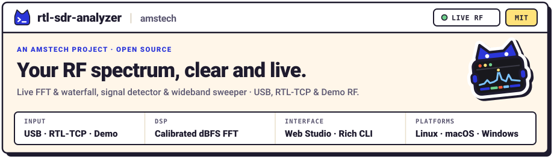
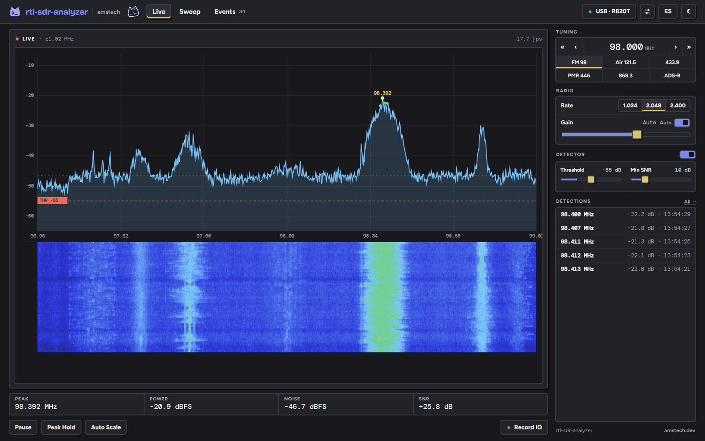
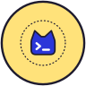

<p align="center">
  
</p>

<p align="center">
  <a href="https://github.com/msalexms/rtl-sdr-analyzer/actions/workflows/ci.yml"></a>
  <a href="https://www.python.org"></a>
  
  
  <a href="LICENSE"></a>
</p>

<p align="center">
  <strong>English</strong> · <a href="README.es.md">Español</a>
</p>

<p align="center">
  <a href="#features">Features</a> ·
  <a href="#quick-start">Quick Start</a> ·
  <a href="#web-studio">Web Studio</a> ·
  <a href="#cli-commands">CLI Commands</a> ·
  <a href="#configuration">Configuration</a> ·
  <a href="#architecture">Architecture</a> ·
  <a href="CHANGELOG.md">Changelog</a>
</p>

---

**rtl-sdr-analyzer** (by **AMSTech**) is a focused, easy-to-use RF spectrum analyzer, signal detector, IQ recorder, and wideband band scanner for RTL-SDR USB dongles and `rtl_tcp` servers.

Instead of drowning you in dozens of obscure demodulator panels or brittle matplotlib windows, it gives you a clean local Web Studio (with zero frontend build steps) and a fast Rich CLI that both work out of the box with:

- **Direct USB RTL-SDR** via pure-Python `ctypes` bindings to `librtlsdr` (no C compiler needed)
- **Network `rtl_tcp`** with proper `RTL0` handshake and byte-aligned I/Q streaming
- **Simulated Demo RF** when no dongle is connected, so you can explore the spectrum and test detections anywhere
- **Recorded IQ replay** (`.raw` / `.cu8` and `.npz`)

<p align="center">
  
</p>
<p align="center"><sub>Web Studio receiving FM broadcast at 98 MHz with a Nooelec NESDR SMArt v5 — live spectrum + waterfall.</sub></p>

---

## Features

- **Live Spectrum & Waterfall** — Smooth HTML5 Canvas FFT plot and waterfall over WebSocket (`Int16` Base64 streaming), with click-to-tune, hover readout, Peak Hold, Auto Scale, and AMSTech / Viridis / Inferno colormaps.
- **Calibrated dBFS DSP** — Pure-NumPy Welch-averaged FFT with selectable windows (`blackmanharris`, `hann`, `hamming`, `rectangular`), DC removal, and linear-domain temporal smoothing.
- **Adaptive Signal Detector** — Robust median/MAD noise floor baseline (not poisoned by strong signals), contiguous `-3 dB` bandwidth measurement, SNR + Z-score criteria, holdover, and anti-spam cooldown.
- **Wideband Frequency Sweeper** — Scans wide frequency spans in overlap-trimmed steps (`0.8 × sample_rate`) to build a stitched wideband spectrum and clickable peak table.
- **IQ Sample Recording** — Capture raw interleaved `uint8` (`.raw` / `.cu8`) or NumPy `.npz` archives (with center frequency, sample rate, and gain metadata) from the live Web Studio or CLI.
- **SQLite History & Export** — Thread-safe WAL SQLite persistence with session tracking, top active frequencies, hourly breakdown, and CSV / JSONL export.
- **AMSTech UI (`EN / ES`)** — Warm paper Day mode (`#FFF6E9`) and soft Graphite Night mode (`#18181D`), local self-hosted fonts (`Bricolage Grotesque`, `Figtree`, `DM Mono`), and zero external CDN requests.

---

## Quick Start

### 1. Install

> [!NOTE]
> This is a **beta** (`3.0.0b1`). Downloads are on the [Releases page](https://github.com/msalexms/rtl-sdr-analyzer/releases).

| Platform | Recommended | Dongle library |
|---|---|---|
| **Windows** | Download `rtl-sdr-analyzer-…-windows-x64.zip`, unzip, run `rtl-sdr-analyzer.exe` (no Python needed) | Included (RTL-SDR Blog driver, V3/V4). Install the WinUSB driver once with [Zadig](https://zadig.akeo.ie). |
| **macOS** | `pipx install --pip-args=--pre rtl-sdr-analyzer` | `brew install librtlsdr` |
| **Linux** | `pipx install --pip-args=--pre rtl-sdr-analyzer` | `sudo apt install librtlsdr0 rtl-sdr` (Debian/Ubuntu) · `sudo dnf install rtl-sdr` (Fedora) |
| **Raspberry Pi / server** | `docker run -d --device /dev/bus/usb -p 8080:8080 -v sdr-data:/data ghcr.io/msalexms/rtl-sdr-analyzer:beta` | Included in the image |

Standalone archives for macOS (arm64/x64) and Linux (x64/arm64) are also published; each has a `README-FIRST.txt`.

- **Windows SmartScreen / macOS Gatekeeper:** beta builds are not code-signed yet. Windows: *More info → Run anyway*. macOS archive: `xattr -dr com.apple.quarantine rtl-sdr-analyzer`.
- **Linux "device busy":** blacklist the DVB-T driver once: `echo 'blacklist dvb_usb_rtl28xxu' | sudo tee /etc/modprobe.d/blacklist-rtl.conf`, then replug the dongle.
- **Docker exposes the Studio to your network without authentication.** Only run it on networks you trust.

From source (development):

```bash
git clone https://github.com/msalexms/rtl-sdr-analyzer.git
cd rtl-sdr-analyzer
python -m venv .venv && source .venv/bin/activate   # Windows: .venv\Scripts\activate
pip install -e ".[dev,test]"
```

### 2. Check your dongle

```bash
rtl-sdr-analyzer devices
```

### 3. Open the Web Studio

```bash
rtl-sdr-analyzer serve --open
```

By default `--source auto` picks your attached USB RTL-SDR dongle first, falls back to `rtl_tcp` on `127.0.0.1:1234` if reachable, or starts **Simulated Demo RF** so the interface always opens cleanly.

### Docker

```bash
cd docker
docker compose up -d
```

Open `http://127.0.0.1:8080`.

---

## Web Studio

- **Tabs (`1` / `2` / `3`)**: Switch between **Live** (spectrum + waterfall + receiver/detector controls), **Sweep** (wideband scanner), and **Events** (detection log, top frequencies, CSV/JSONL export).
- **Shortcuts**: `Space` pauses/resumes the stream, `P` toggles Peak Hold, `A` auto-scales, `R` starts/stops IQ recording, `1`/`2`/`3` switch tabs, `←` / `→` steps center frequency by ±100 kHz, and clicking anywhere on the spectrum tunes straight to that frequency.
- **Source Modal**: Click **Source** in the header anytime to scan USB devices, connect to an `rtl_tcp` server, or switch to Demo RF.

---

## CLI Commands

| Command | Purpose | Example |
|---|---|---|
| `serve` *(default)* | Start local FastAPI + WebSocket Web Studio | `rtl-sdr-analyzer serve --freq 98e6 --open` |
| `devices` | Inspect `librtlsdr` path and attached USB dongles | `rtl-sdr-analyzer devices` |
| `analyze` | Headless console analyzer & detector | `rtl-sdr-analyzer analyze --freq 446e6 --db-path events.db` |
| `sweep` | Wideband frequency scan with Rich peaks table | `rtl-sdr-analyzer sweep 88e6 108e6 --dwell 0.3` |
| `record` | Capture raw `.raw` or `.npz` IQ samples | `rtl-sdr-analyzer record fm.npz --format numpy --duration 10` |
| `stats` | View SQLite session/event summary and export CSV | `rtl-sdr-analyzer stats events.db --export-csv out.csv` |
| `config-validate` | Validate a YAML configuration file | `rtl-sdr-analyzer config-validate config/default.yml` |
| `config-show` | Print resolved config (defaults → YAML → env → CLI) | `rtl-sdr-analyzer config-show --format json` |

---

## Configuration

Precedence (lowest → highest): **Code defaults → YAML file (`--config`) → Environment variables (`RTL_SDR__*`) → CLI flags**.

See [config/default.yml](config/default.yml) and [.env.example](.env.example).

```yaml
source:
  mode: "auto" # auto | usb | rtl_tcp | simulated | file
  device_index: 0

receiver:
  frequency: 98000000
  sample_rate: 2048000
  fft_size: 2048
  gain: null # null = auto gain
  direct_sampling: 0
```

---

## Architecture

| Module | Responsibility |
|---|---|
| `sources/` | `LocalUsbSource` (`ctypes` `librtlsdr`), `RtlTcpSource` (`RTL0` + command opcodes), `SimulatedSource`, `FileReplaySource`, `create_source` |
| `dsp/` | Pure-NumPy calibrated dBFS Welch FFT (`blackmanharris`, `hann`, `hamming`, `rectangular`), median/MAD floor, `-3 dB` bandwidth, peak finder |
| `detection/` | `SignalDetector` (adaptive baseline, holdover, anti-spam cooldown), `SignalEvent`, `SpectrumFrame` |
| `engine/` | Thread-safe `SpectrumEngine` (live reconfiguration, recording tap, exclusive lock for sweeping), `FrequencySweeper`, `EventBus` |
| `storage/` & `recording/` | Thread-safe WAL SQLite `EventStore`, AMSTech Rich `StatsDashboard`, `IQRecorder`, `CsvExporter`, `JsonExporter` |
| `web/` | FastAPI REST + WebSocket (`Int16` Base64 frames) + zero-build AMSTech UI v1.5 frontend |
| `cli/` | Thin Typer CLI wrapping the engine and Web Studio |

---

## Development

```bash
pip install -e ".[dev,test]"
ruff check src tests
ruff format --check src tests
mypy --strict src
pytest
```

---

## License

Copyright (c) 2026 Alejandro Martín (AMSTech). Released under the [MIT License](LICENSE).

<p align="center">
  <picture>
    <source media="(prefers-color-scheme: dark)" srcset="docs/brand/seal-en-dark.svg">
    
  </picture>
</p>

<p align="center">
  <strong>An AMSTech project</strong> · Built for me, shared with all · <a href="https://amstech.dev">amstech.dev</a>
  <br>
  <a href="LICENSE">MIT</a> © 2026 Alejandro Martín (AMSTech) · <a href="CHANGELOG.md">Changelog</a>
</p>
